# Notita · recordatorios que se pegan

App de recordatorios para **iOS, iPadOS, Android** (móvil y tablet) y **web** con libretas, calendario, agenda, cumpleaños y aniversarios, widgets tipo pósit personalizables y un diseño pastel tranquilo. Tiene **estilo cristal** en todas las plataformas: el Liquid Glass del sistema en iOS 26+, superficies translúcidas en Android y cristal desenfocado en la web, con la **transparencia ajustable**.

- **Android**: descarga el APK en [Releases](https://github.com/ElDumixx/notita/releases/latest).
- **iPhone sin App Store**: abre **https://eldumixx.github.io/notita/** en Safari → botón Compartir → **«Añadir a pantalla de inicio»**. Se abre a pantalla completa, como una app (ver [Versión web](#versión-web-iphone-con-safari)).

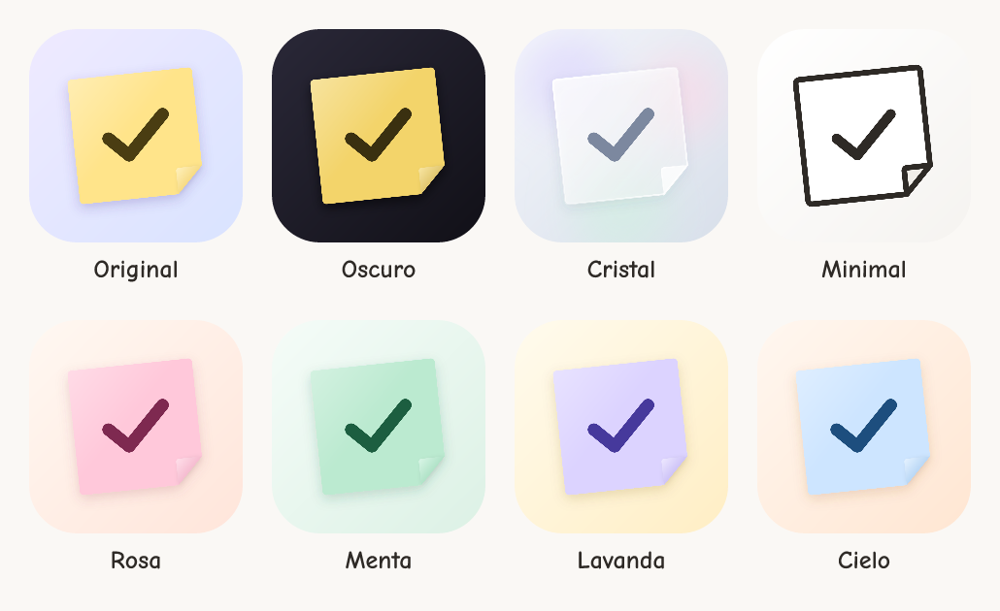

| Hoy | Nuevo recordatorio | Libretas (oscuro) | Editor de widget |
| --- | --- | --- | --- |
| 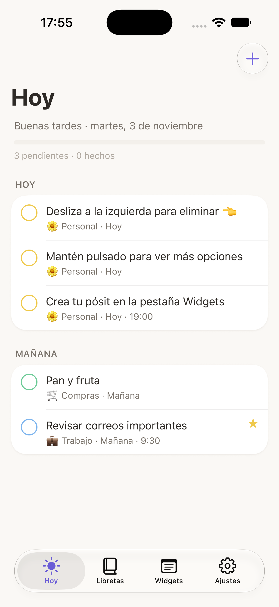 | 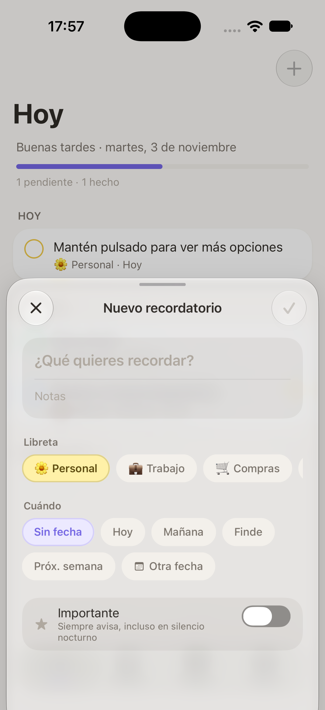 | 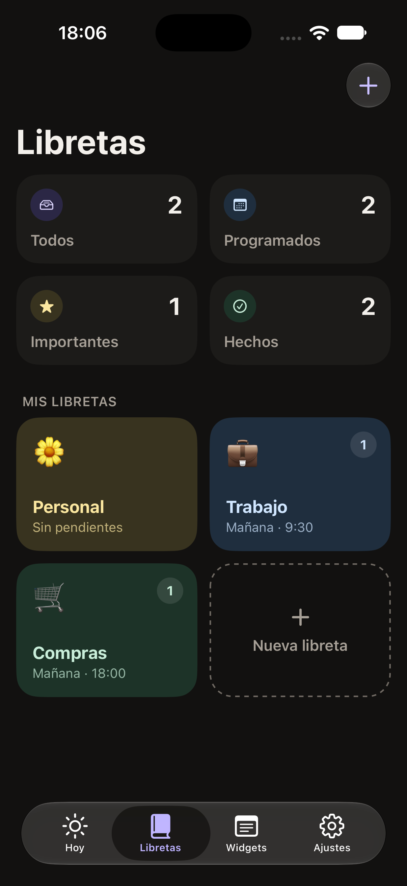 | 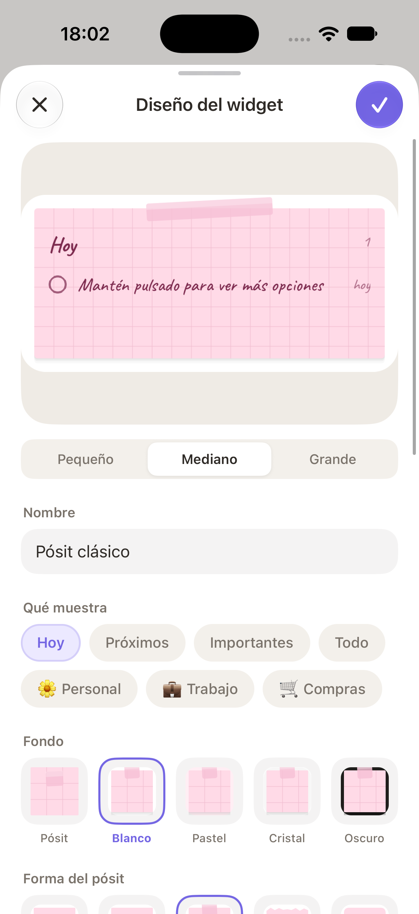 |

| Widget en iOS | Iconos de la app | Android | Widget en Android |
| --- | --- | --- | --- |
| 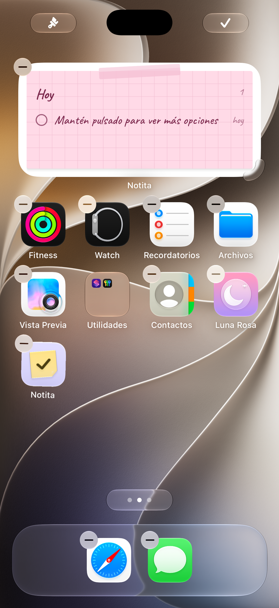 | 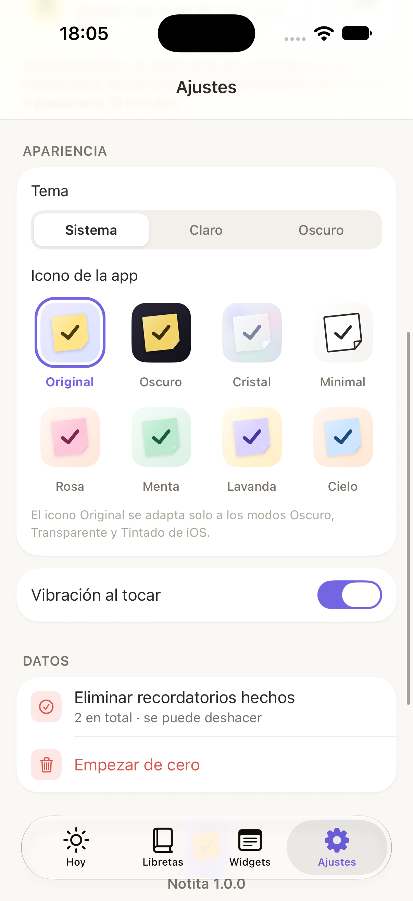 | 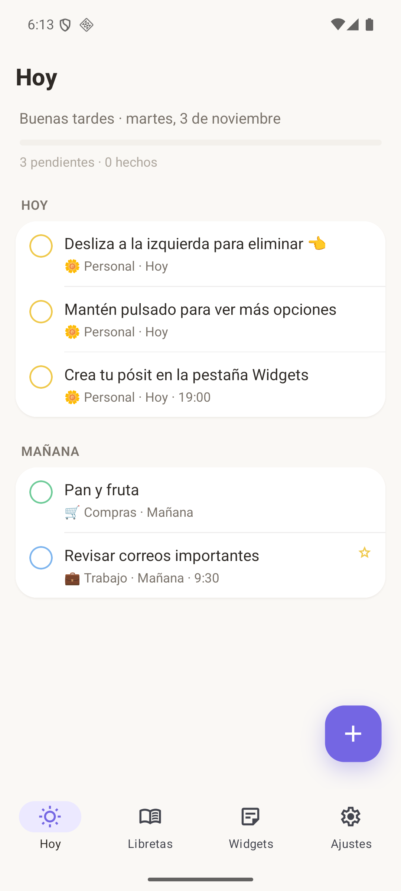 | 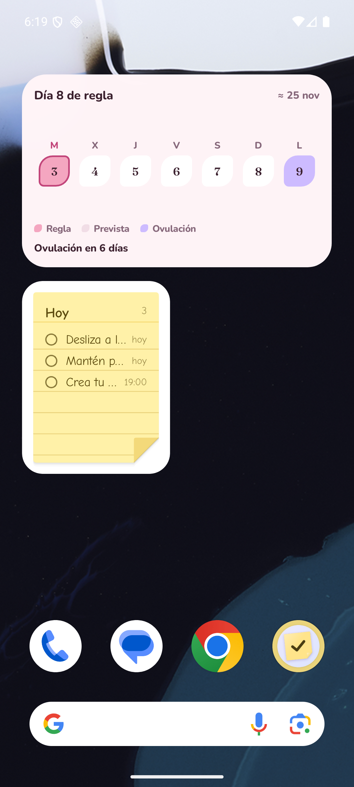 |

| Cristal en iOS | Ajuste de transparencia | Widget con iOS «Traslúcido» | Cristal en Android |
| --- | --- | --- | --- |
| 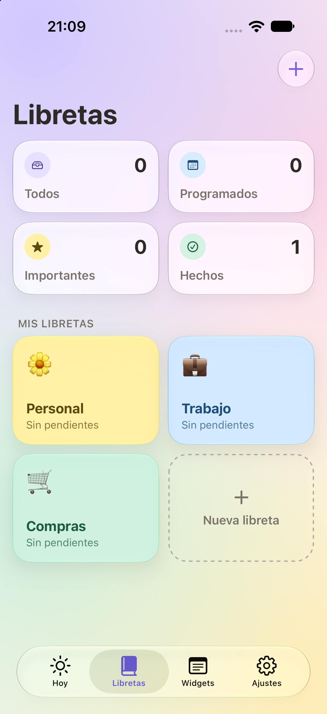 | 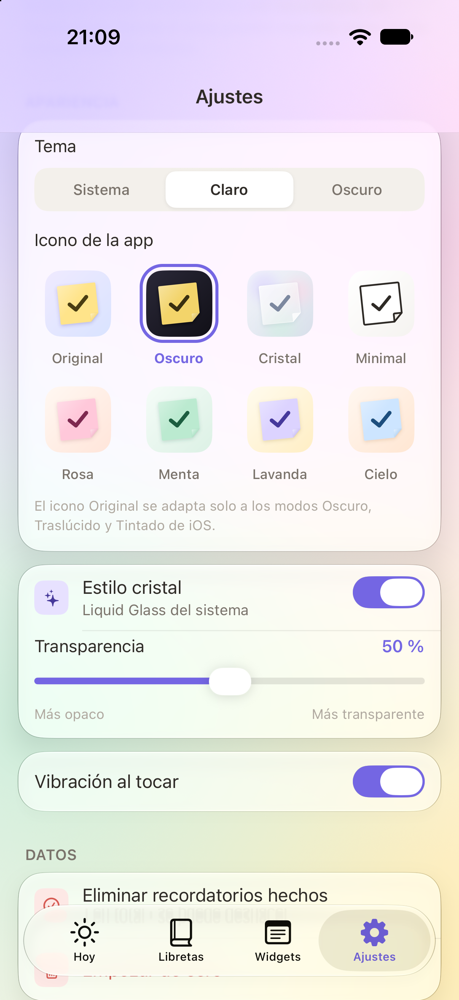 | 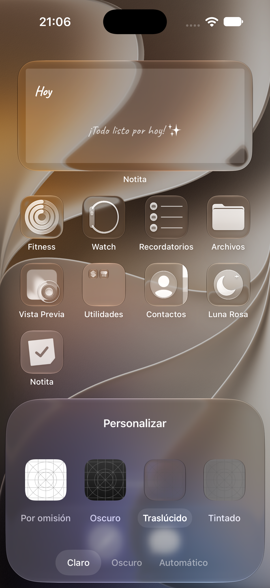 | 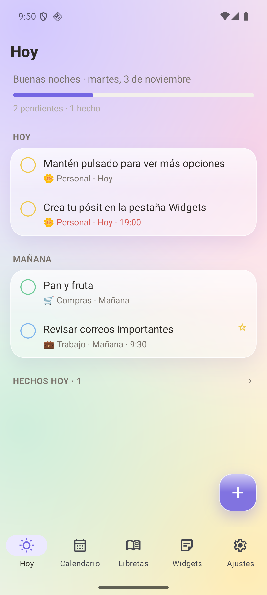 |

| Menú flotante (Android) | Aniversarios | Web en el iPhone | iPad |
| --- | --- | --- | --- |
| 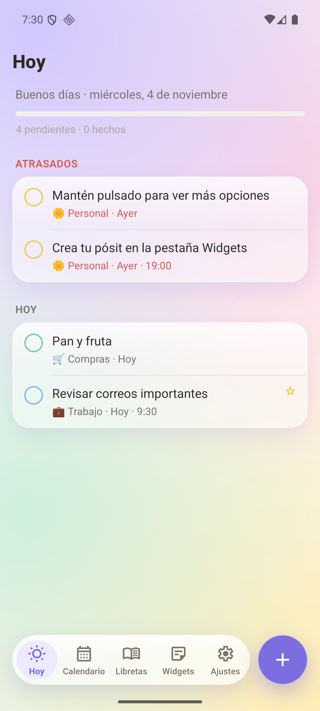 | 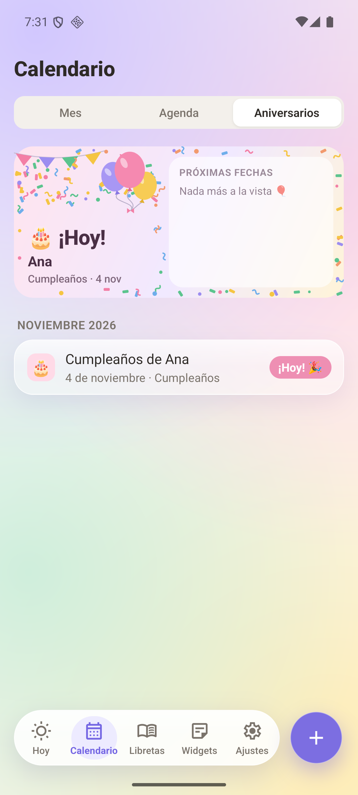 | 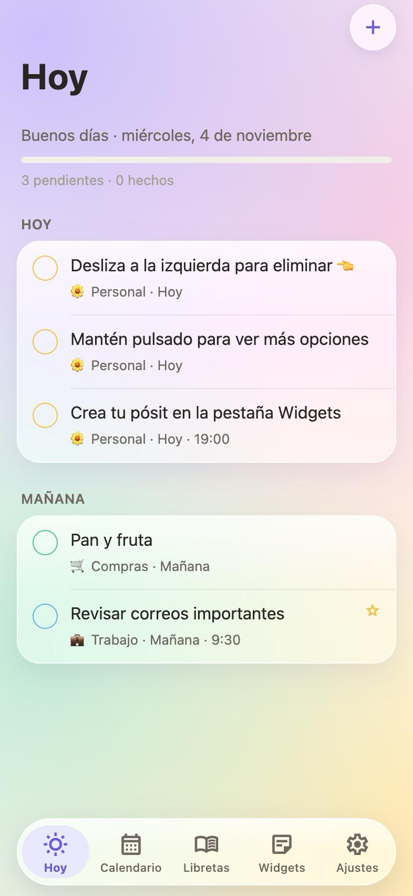 | 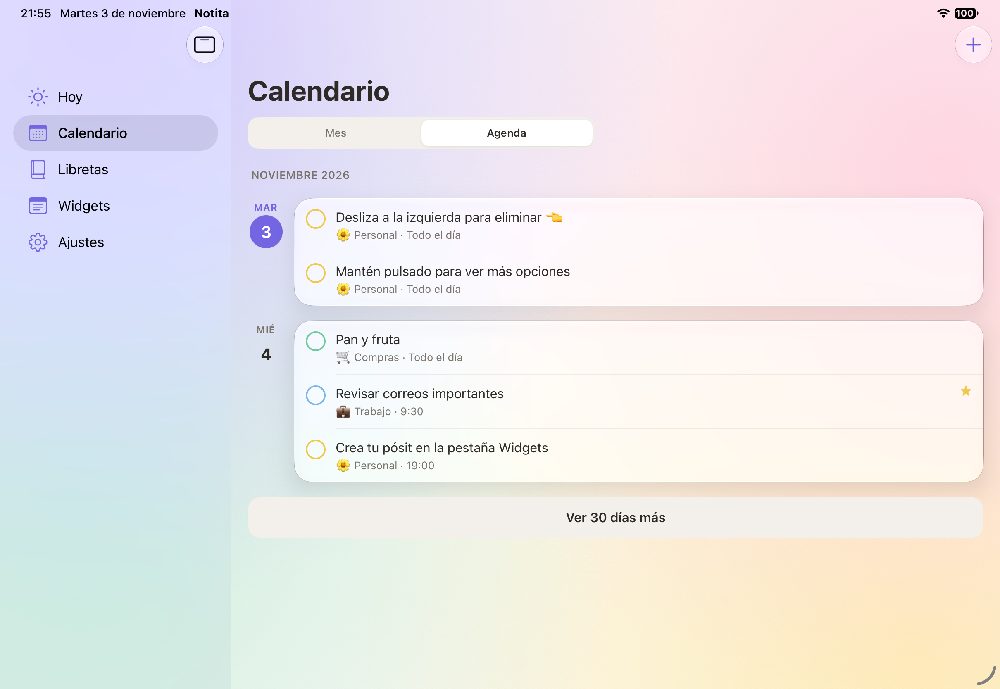 |

| Widget «Importantes» (iOS) | Widget «Aniversarios» (iOS) |
| --- | --- |
| 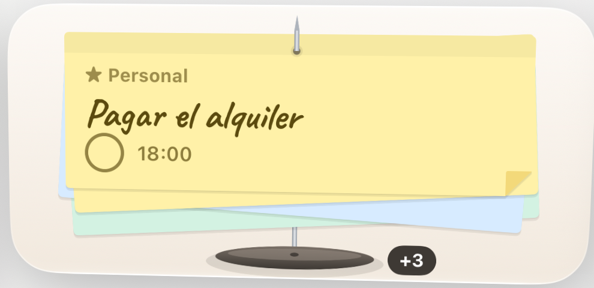 | 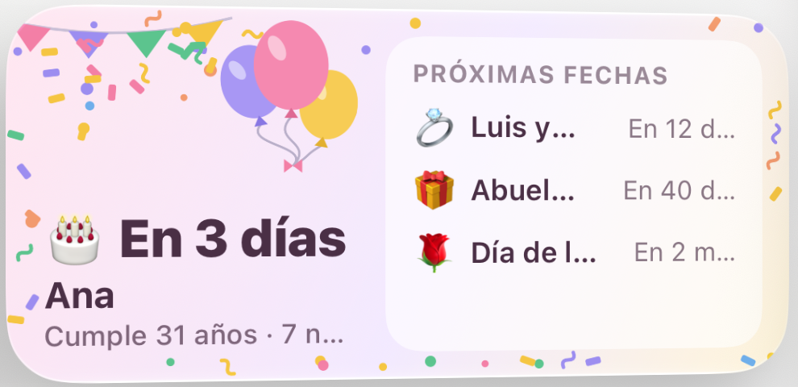 |

## Qué incluye

- **Libretas** para separar recordatorios por tipo (Personal, Trabajo, Compras, Estudios, Salud, Hogar, Ideas, Viajes), con emoji y color pastel. Listas inteligentes: Todos, Programados, Importantes y Hechos.
- **Recordatorios** con notas, fecha y hora (atajos: hoy, mañana, finde, próxima semana, 9:00, 13:00…), repetición (diaria, semanal, mensual, anual) e "importante".
- **Calendario** (pestaña Calendario → Mes): vista mensual con un punto de color por recordatorio (el color de su libreta). Toca un día para ver lo que tiene y añadir un recordatorio ese mismo día; desliza a los lados para cambiar de mes. Los recordatorios que se repiten aparecen en todos los días que les tocan (con un círculo discontinuo).
- **Agenda** (pestaña Calendario → Agenda): lo atrasado arriba y después, día a día, todo lo que viene en los próximos 30 días, con «Ver 30 días más».
- **Cumpleaños y aniversarios** (pestaña Calendario → Aniversarios): cumpleaños, aniversarios u otras fechas que vuelven cada año, con emoji y color. Si sabes el año, cuenta los que cumple («Cumple 31 años»). **Avisos antes de la fecha**: el mismo día, 1 día, 3 días, 1 semana o 2 semanas antes, a la hora que elijas. Salen en el mes (punto de color), en el día y en la agenda; desde cualquier día del calendario se añaden con «Fecha especial».
- **Tablets (iPad y Android)**: las pantallas se reorganizan según el espacio. Hoy pasa a dos columnas, Libretas y Widgets a 3–4 columnas, el calendario muestra el mes y el día seleccionado lado a lado, y las listas y formularios se centran con un ancho cómodo de leer. Funciona en vertical, horizontal, Split View y Stage Manager; en iPad la barra de pestañas puede pasar a barra lateral, y el widget de iOS tiene tamaño extra grande.
- **Eliminar de verdad**: deslizar a la izquierda, mantener pulsado (menú), botón en el editor, "Borrar hechos" por libreta o en Ajustes, y eliminar libretas enteras (o mover sus recordatorios). Siempre con **Deshacer** durante 7 segundos.
- **Notificaciones sin agobiar**: un único aviso por recordatorio (a la hora o 15 min / 1 h / 1 día antes), sin repeticiones; los avisos que coinciden en 10 minutos se juntan en uno; **silencio nocturno** (los avisos esperan a la mañana, salvo los importantes); resumen de la mañana opcional (solo si hay algo). Desde el aviso: **Hecho** o **Posponer 10 min**. El permiso se pide solo al crear el primer aviso.
- **Widget «Importantes»** (iOS y Android): los recordatorios marcados como importantes, **clavados en una aguja** como en un pincho de notas. Delante está el que toca y detrás asoman los siguientes, cada uno girado a su manera. Al tocar el círculo se marca como hecho, sale de la aguja y aparece el siguiente; si no queda ninguno, la aguja se queda vacía con «No hay recordatorios importantes».
- **Widget «Aniversarios»** (iOS y Android): diseño de cumpleaños con **globos, banderines y confeti** y la cuenta atrás de la próxima fecha («🎂 En 3 días · Ana · Cumple 31 años»). En mediano y grande, la lista de las siguientes. En iOS también para la pantalla de bloqueo.
- **Widgets tipo pósit** (pequeño, mediano y grande en iOS; redimensionable en Android) creados en la pestaña Widgets:
  - Qué muestra: Hoy, Próximos, Importantes, Todo o una libreta concreta.
  - Fondo: pósit completo, blanco, pastel, cristal u oscuro. En Android el cristal deja ver el fondo de pantalla y su transparencia se ajusta con un deslizador; en iOS el sistema pone una base opaca bajo los widgets, así que el cristal de verdad lo aplica iOS al elegir el estilo «Traslúcido» de la pantalla de inicio.
  - Forma: clásico, esquina doblada, cinta adhesiva, papel rasgado o redondeado.
  - Papel: liso, rayas, cuadros o puntos.
  - Color: el de la libreta, 8 pasteles o blanco. Tinta: a juego, grafito, bolígrafo o burdeos.
  - Letra: Cómic, A mano, Sans Serif, Redondeada, Serif, Máquina de escribir y Rotulador.
  - Tocar el círculo marca el recordatorio como hecho desde la pantalla de inicio.
- **Icono cambiable**: Original, Oscuro, Cristal, Minimal, Rosa, Menta, Lavanda y Cielo. El Original de iOS está hecho con Icon Composer, así que además se adapta solo a los modos Oscuro, Traslúcido y Tintado del sistema. En Android incluye icono monocromo para los iconos temáticos.
- **Estilo cristal** (Ajustes → Apariencia), activado por defecto:
  - iOS 26+: tarjetas, listas, botones y hojas con el Liquid Glass del sistema.
  - Android: superficies translúcidas con borde de luz y brillo suave; la barra de pestañas y los botones de arriba **desenfocan de verdad** lo que pasa por detrás (Android 12 o superior), como el cristal de iOS. El Liquid Glass nativo es de Apple y no existe en Android: esto es lo más parecido.
  - En los dos, un fondo pastel en degradado detrás del cristal para que se note la transparencia.
  - **Transparencia** ajustable con un deslizador, de «Más opaco» a «Más transparente». Se puede desactivar del todo, y en iOS respeta «Reducir transparencia».
- **Android con el diseño de iPhone**: título grande que se encoge al hacer scroll (y aparece una barra de cristal con el título pequeño), botones redondos de cristal arriba (**+** y volver) y la barra de pestañas como cápsula flotante con una «lente» que se desliza a la pestaña activa, igual que en iOS 26.
- Tema claro/oscuro/sistema y vibración opcional.
- **Animaciones discretas**, siempre con un motivo: al marcar una tarea la casilla se rellena y la tarea se va un instante después, la barra de progreso se pone verde al terminar el día, el control segmentado desliza su pastilla, los botones ceden un poco al pulsarlos y el pósit de las pantallas vacías «respira». En iOS usan muelles suaves como los del sistema; en **Android son más sobrias** (sin rebotes, más cortas y con la curva estándar de Material 3). Todas respetan «Reducir movimiento».

> **Sobre Comic Sans**: es una fuente de Microsoft y no se puede incluir en una app. En su lugar va **Comic Neue**, su equivalente libre. Todas las fuentes incluidas son libres (OFL / Apache 2.0; licencias en `assets/fonts/licenses`).

## Probarla

### APK de Android

Descarga `Notita-1.3.0.apk` de [Releases](https://github.com/ElDumixx/notita/releases/latest) (firmado con la clave de depuración, válido para instalar y probar; no para Google Play). Ábrelo en el móvil (permite «instalar apps desconocidas» si lo pide), o con el móvil conectado:

```bash
adb install Notita-1.3.0.apk
```

### Versión web (iPhone con Safari)

La misma app, con el mismo diseño de iOS (títulos grandes, barra de pestañas flotante de cristal, hojas que suben desde abajo), funciona en el navegador: **https://eldumixx.github.io/notita/**

1. Ábrela en **Safari** en el iPhone.
2. Toca **Compartir** → **«Añadir a pantalla de inicio»**.
3. Ábrela desde su icono: va a pantalla completa, sin barras de Safari. (En Safari normal, la barra de Safari ocupa la parte de abajo; eso no lo puede quitar ninguna web.)

Con la app en la pantalla de inicio, iOS 26 tiene un fallo (WebKit 301108) que deja una franja vacía abajo; la web lo corrige estirando la página hasta el borde real de la pantalla.

Limitaciones de la web (las pone iOS, no la app): **no hay avisos** con la app cerrada ni **widgets**, y los datos se guardan en ese navegador (no se comparten con la app de iOS o Android). Las apps web de iOS van en la **pantalla de inicio**, no en la de bloqueo; los widgets de la pantalla de bloqueo son de la app nativa de iOS. Los iconos de la web son Material Symbols, porque los SF Symbols de Apple no se pueden usar fuera de sus sistemas.

Para publicar una versión nueva de la web en GitHub Pages:

```bash
npm run deploy:web
```

### En el ordenador (desarrollo)

Requisitos: Node 20+, Xcode (iOS) y Android Studio/SDK + JDK 17–21 (Android).

```bash
npm install
```

```bash
npx expo run:ios
```

```bash
npx expo run:android
```

La app usa código nativo (widgets, iconos), así que **no funciona en Expo Go**: hay que usar `expo run` o una build de EAS.

### En un iPhone real / App Store

1. Añade tu Team ID de Apple en `app.json` → `expo.ios.appleTeamId`.
2. Si cambias el identificador `com.paulbumb.notita`, cambia también el App Group `group.com.paulbumb.notita` en `app.json` y en `src/lib/widget-sync.ios.ts` y `targets/widget/Data.swift`.
3. `npx expo prebuild --clean` y abre `ios/Notita.xcworkspace` en Xcode, o usa EAS:

```bash
npx eas-cli@latest build -p ios
```

Para un APK/AAB de producción con tu propia firma: `npx eas-cli@latest build -p android`.

## Estructura

```
src/app/            Rutas (Expo Router): pestañas Hoy, Calendario, Libretas, Widgets, Ajustes y hojas de edición
src/screens/        Pantallas
src/components/     Piezas de interfaz (fila deslizable, casilla, vista previa del pósit, cristal…)
src/store/          Datos (Zustand + SQLite) y selectores
src/lib/            Fechas, notificaciones, dibujo del pósit (SVG) y sincronización con widgets
src/widgets/        Widgets de Android: pósit, aguja de importantes y aniversarios (react-native-android-widget)
targets/widget/     Widgets de iOS en SwiftUI (WidgetKit + App Intents)
public/             Página, manifiesto e iconos de la versión web (app instalable desde Safari)
scripts/            Publicar la web en GitHub Pages
assets/             Iconos (incluye notita.icon de Icon Composer), fuentes y splash
```

El dibujo de los widgets (`src/lib/postit-art.ts`, `spike-art.ts` y `festive-art.ts`) es el mismo para la vista previa de la app y los widgets de Android, y los de iOS replican esa geometría en SwiftUI (`targets/widget/*.swift`), por eso se ven iguales.

## Pendiente de probar

Comprobado en el simulador de iPhone (iOS 27), en un emulador de Android 16 (móvil y tablet) y en el navegador con tamaño de iPhone, incluidos el estilo cristal, el menú flotante, los aniversarios y los widgets nuevos. No se ha probado todavía: la llegada real de una notificación (con sus botones Hecho/Posponer y los avisos de aniversarios), la versión web en un iPhone físico añadida a la pantalla de inicio, los widgets de aniversarios en la pantalla de bloqueo de iOS, el modo oscuro en Android con el menú nuevo y la app en dispositivos físicos. En Android 14+, para que los avisos lleguen al minuto exacto el usuario puede tener que permitir "Alarmas y recordatorios" para Notita en los ajustes del sistema.
